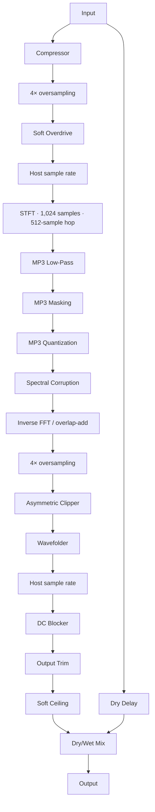

# Filth audio path

FILTH is a normalized value from 0 to 1. The DSP ramps changes over 20 ms.
In the table, `S(a,b)` is a smoothstep ramp from 0 to 1 between the indicated
knob percentages. Compressor settings update per processing block, spectral
settings update per FFT hop, and drive and output settings update per sample.

| Debug stage | What FILTH controls | Other settings |
| --- | --- | --- |
| **Compressor** | With `c = S(0,70)`, threshold is `−30 × c dB` and ratio is `(1 + 15 × c):1`. | 3 ms attack, 60 ms release. |
| **Soft Overdrive** | Blend `d = S(0,50)` into the tanh-shaped signal. Pre-gain is `1 + 10 × d`. | Runs inside the first 4× oversampling pass. |
| **MP3 Low-Pass** | Spectral strength `m = S(18,100)^1.25`. Cutoff moves geometrically from Nyquist to `min(3,600 Hz, 0.8 × Nyquist)` as `m` increases, rounded down to a retained FFT bin. | Brickwall bin cutoff. |
| **MP3 Masking** | Band gate is `0.20 × m` of the frame peak. Bin gate is `0.62 × m` of the band peak. | Band width grows with frequency. |
| **MP3 Quantization** | Step size is `0.48 × m²` of the band peak. | Rounds real and imaginary bin coefficients. |
| **Spectral Corruption** | Corrupted spectrum blend is `sqrt(S(50,100))`, with power compensation. | Phase is scrambled, bins shift by 7–25 positions, and selected frames drop to 24% gain. The panel shows the latest frame's shift and gain. Disabling MP3 Low-Pass lets corruption use the full input spectrum. |
| **Asymmetric Clipper** | Blend `a = S(22,67)` into the clipped signal. Pre-gain is `1 + 3.5 × a`. | Clips at −0.57 and +0.87 in the second 4× oversampling pass. |
| **Wavefolder** | Blend `w = S(42,86)` into the folded signal. Pre-gain is `1 + 4 × w`. | Triangle fold after the Asymmetric Clipper. |
| **DC Blocker** | Fixed. | 15 Hz high-pass, after the second oversampling pass. |
| **Output Trim** | Wet gain is `1 − 0.35 × S(0,50) × (1 − S(50,80))`. It bottoms out near −3.74 dB at 50%. | Gain returns to unity at 80%. |
| **Soft Ceiling** | Fixed. | Soft knee at 0.90 amplitude (−0.92 dBFS), approaching a ceiling of 1.0 (0 dBFS). |
| **Dry/Wet Mix** | Wet fraction is `S(0,18)`. At 0% FILTH, the output is the delayed dry signal. | Dry Delay compensates for 1,024 STFT samples plus 61 samples per oversampling pass, for 1,146 samples total. |

## Debug panel

Click the upper-right corner screw to switch views. The checkboxes enable and
bypass individual stages. **Solo** enables only that row, and clicking it again
enables all stages. **Bypass all** plays latency-aligned dry audio so you can
compare against a repeatable reference. Disabling **Dry/Wet Mix** while other
stages are enabled passes the wet chain at 100%.

The readouts show settings sampled from audio processing, including configured
settings for bypassed rows. The oversampling filters and STFT remain in the wet
path to keep timing stable. Stage changes apply at the next block or FFT hop.
Closing the panel or editor restores all stages. The switches are temporary and
live separately from Live's saved plugin state and automation.
